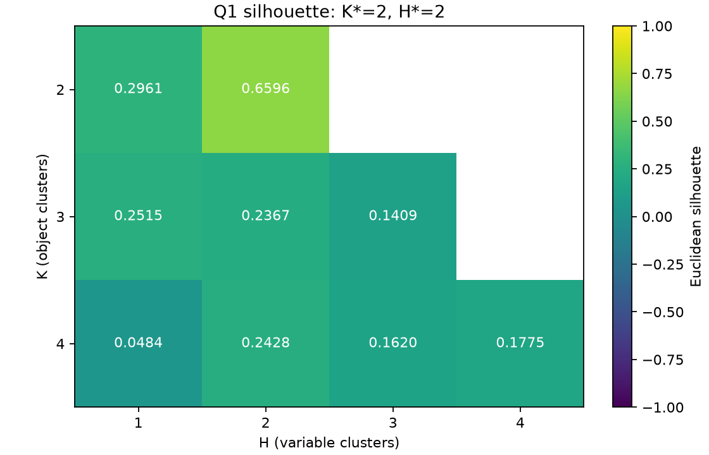
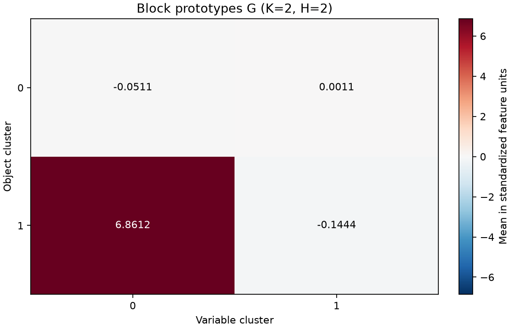
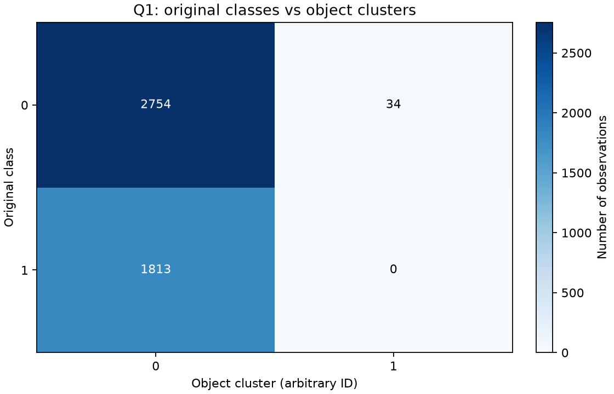
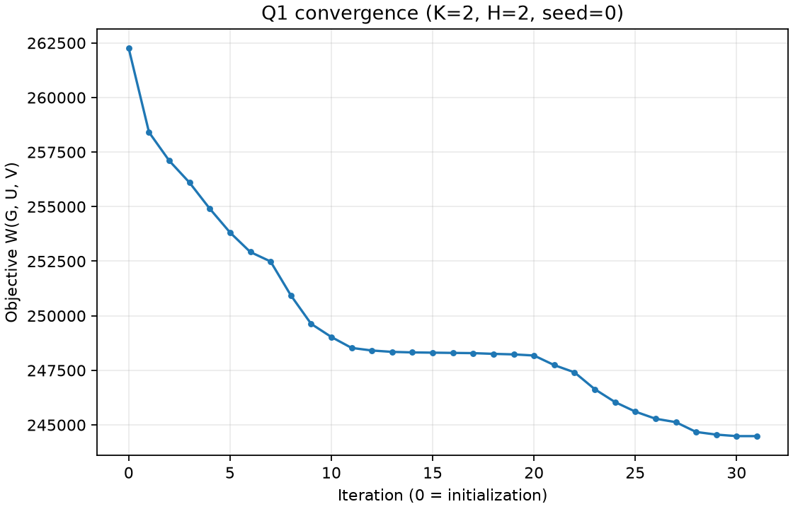
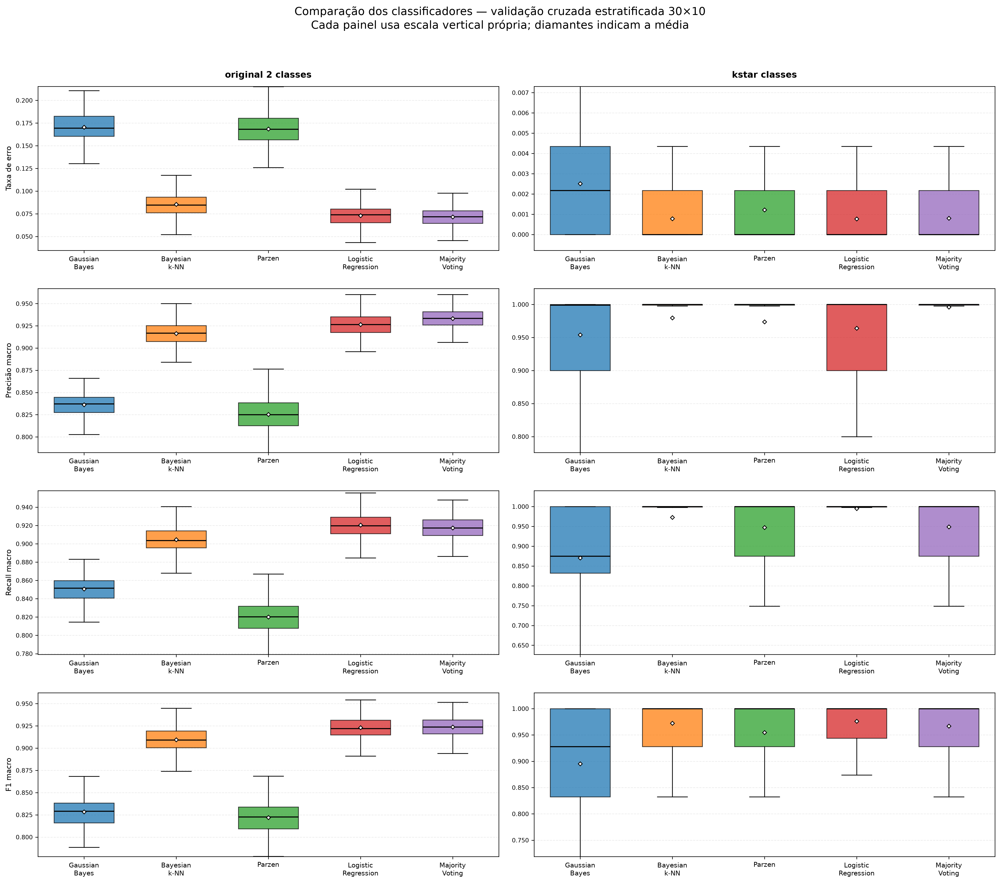
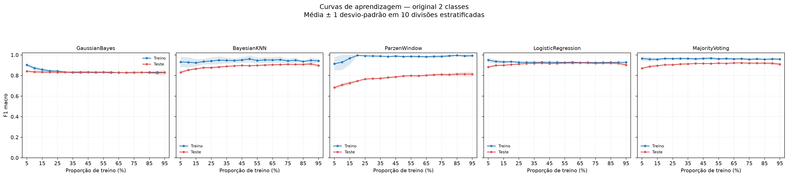
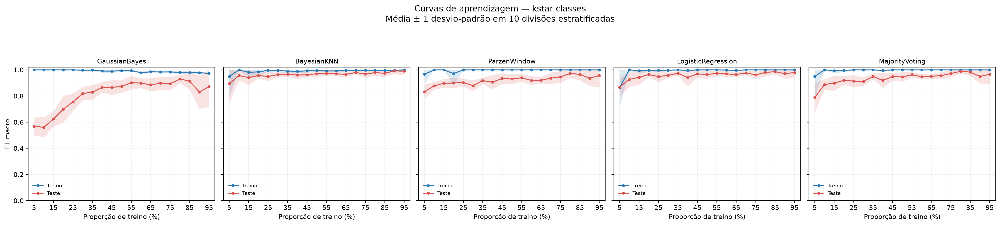

# Relatório Técnico — Projeto de Aprendizagem de Máquina 2026-2

**Instituição:** Centro de Informática — CIn/UFPE  
**Disciplina:** Aprendizagem de Máquina (2026.2) — Prof. Francisco de A. T. de Carvalho  
**Data:** Novembro de 2026  

---

## 1. Resumo Executivo

Este relatório apresenta o desenvolvimento experimental completo e a avaliação estatística do projeto da disciplina de Aprendizagem de Máquina sobre a base de dados **Spambase** ($4.601$ exemplos e $57$ atributos contínuos). O estudo divide-se em duas etapas principais:

1. **Questão 1 — Agrupamento Co-clustering via Double K-Means:** Foram realizadas $900$ execuções independentes ($100$ inicializações para cada um dos $9$ pares $(K, H)$ com $K \in \{2, 3, 4\}$ e $H \in \{1, \dots, K\}$) sobre a base padronizada por *z-score*. Para cada par $(K, H)$, selecionou-se a partição de menor função objetivo $W(\mathbf{G}, \mathbf{U}, \mathbf{V})$. O índice de Silhueta selecionou como ótimo o par **$(K^*, H^*) = (2, 2)$** ($\text{Sil} = 0{,}65963094$, $W = 244.486{,}70$). O Índice de Rand Corrigido em relação às classes originais (*spam* / *não-spam*) foi **$\text{ARI} = -0{,}00494970$**, demonstrando que a estrutura geométrica não-supervisionada isola um pequeno grupo de $34$ exemplos ($0{,}74\%$) com valores extremos em $11$ atributos, e não a divisão semântica *spam* vs. *não-spam*.
2. **Questão 2 — Avaliação e Comparação de Classificadores Supervisionados:** Avaliaram-se cinco classificadores (**Bayesiano Gaussiano**, **Bayesiano k-Vizinhos**, **Bayesiano Janela de Parzen**, **Regressão Logística** e **Voto Majoritário**) em duas versões da base Spambase (`original_2_classes` e `kstar_classes`), utilizando validação cruzada estratificada aninhada **$30 \times 10$-folds** com validação interna de **5-folds** para ajuste de hiperparâmetros ($3.000$ avaliações externas), testes não-paramétricos de **Friedman** e pós-teste de **Nemenyi**, além de **curvas de aprendizagem** de $5\%$ a $95\%$ com passo de $5\%$ ($1.900$ avaliações).
   - Em `original_2_classes`, **MajorityVoting** ($F_1 = 0{,}9238$, $\text{Erro} = 0{,}0716$) e **LogisticRegression** ($F_1 = 0{,}9230$, $\text{Erro} = 0{,}0730$) alcançaram os melhores desempenhos (estatisticamente equivalentes em F1 pelo teste de Nemenyi, $p = 0{,}7205$, e significativamente superiores aos demais, $p \le 2{,}78 \times 10^{-15}$).
   - Em `kstar_classes`, **LogisticRegression** ($F_1 = 0{,}9762$), **BayesianKNN** ($F_1 = 0{,}9722$) e **MajorityVoting** ($F_1 = 0{,}9668$) lideraram sem diferença estatística significativa entre si ($p \ge 0{,}7127$).

---

## 2. Introdução e Descrição dos Dados

A base de dados **Spambase** (UCI Machine Learning Repository) contém $N = 4.601$ mensagens de e-mail descritas por $d = 57$ atributos contínuos e uma variável alvo binária:
- **Atributos 1 a 48 (`word_freq_*`):** frequência percentual ($[0, 100]$) de 48 palavras específicas na mensagem (ex.: `make`, `address`, `free`, `credit`, `hp`, `george`).
- **Atributos 49 a 54 (`char_freq_*`):** frequência percentual ($[0, 100]$) de 6 caracteres especiais (`;`, `(`, `[`, `!`, `$`, `#`).
- **Atributos 55 a 57 (`capital_run_length_*`):** média (`average`), maior comprimento (`longest`) e soma total (`total`) das sequências ininterruptas de letras maiúsculas.
- **Distribuição das classes a priori (`original_2_classes`):**
  - Classe `0` (*Não-Spam*): $2.788$ exemplos ($60{,}60\%$)
  - Classe `1` (*Spam*): $1.813$ exemplos ($39{,}40\%$)

Características importantes dos dados que impactam diretamente a modelagem:
1. **Discrepância severa de escalas:** Enquanto as frequências percentuais situam-se majoritariamente entre $0$ e $10$, `capital_run_length_total` chega a milhares. Por isso, a padronização por *z-score* é indispensável para métodos baseados em distância (Double K-Means, k-NN) e regularização L2 (Regressão Logística).
2. **Esparsidade e assimetria (zero-inflation):** Muitas palavras raras possuem valor zero em mais de $95\%$ das amostras. Em subamostras pequenas ou classes minoritárias, atributos inteiros podem apresentar variância amostral exatamente zero.

---

## 3. Questão 1 — Agrupamento com Double K-Means

### 3.1 Metodologia
O algoritmo **Double K-Means** realiza o particionamento simultâneo dos $N = 4.601$ objetos em $K$ clusters (matriz indicadora $\mathbf{U}_{N \times K}$) e das $d = 57$ variáveis em $H$ clusters (matriz indicadora $\mathbf{V}_{d \times H}$), estimando uma matriz de protótipos de blocos $\mathbf{G}_{K \times H}$ que minimiza a soma de erros quadráticos intra-bloco:
$$W(\mathbf{G}, \mathbf{U}, \mathbf{V}) = \sum_{i=1}^{N} \sum_{j=1}^{d} \sum_{k=1}^{K} \sum_{h=1}^{H} u_{ik} v_{jh} (x_{ij} - g_{kh})^2$$

Protocolo experimental executado:
- **Pré-processamento:** Padronização *z-score* por coluna (média $0$ e desvio-padrão $1$) sobre os 57 atributos, sem utilizar a variável resposta.
- **Grade de pares $(K, H)$:** $K \in \{2, 3, 4\}$ e, para cada $K$, $H \in \{1, \dots, K\}$, totalizando $9$ pares: $(2,1), (2,2), (3,1), (3,2), (3,3), (4,1), (4,2), (4,3), (4,4)$.
- **Repetições:** $100$ inicializações aleatórias independentes (sementes `0` a `99`) por par $(K, H)$, totalizando **$900$ execuções** (todas as $900/900$ convergiram dentro do limite de 100 iterações).
- **Seleção:** Para cada par $(K, H)$, selecionou-se a repetição de menor função objetivo $W$. Em seguida, calculou-se o índice de Silhueta Euclidiana ($\text{Sil}(K, H)$) sobre a partição de objetos $\mathbf{U}$ de cada vencedor, escolhendo $(K^*, H^*) = \arg\max_{(K, H)} \text{Sil}(K, H)$.

### 3.2 Resultados da Questão 1

#### Seleção por Função Objetivo e Silhueta

| $K$ | $H$ | Execuções | Melhor Semente | Melhor Objetivo $W$ | Convergiu | Silhueta ($\text{Sil}$) |
| :---: | :---: | :---: | :---: | :---: | :---: | :---: |
| 2 | 1 | 100 | 0 | $256.513{,}7482$ | Sim | $0{,}29609380$ |
| **2** | **2** | **100** | **0** | **$244.486{,}6983$** | **Sim** | **$0{,}65963094$** |
| 3 | 1 | 100 | 0 | $254.414{,}0129$ | Sim | $0{,}25146824$ |
| 3 | 2 | 100 | 82 | $239.421{,}7854$ | Sim | $0{,}23673145$ |
| 3 | 3 | 100 | 7 | $234.585{,}8664$ | Sim | $0{,}14092129$ |
| 4 | 1 | 100 | 0 | $253.278{,}6795$ | Sim | $0{,}04842578$ |
| 4 | 2 | 100 | 3 | $233.358{,}7022$ | Sim | $0{,}24279690$ |
| 4 | 3 | 100 | 8 | $228.516{,}4437$ | Sim | $0{,}16196117$ |
| 4 | 4 | 100 | 18 | $227.250{,}8751$ | Sim | $0{,}17745596$ |

- **Par vencedor:** **$(K^*, H^*) = (2, 2)$**, com **$\text{Sil} = 0{,}65963094$** (mais que o dobro de qualquer outro par).

#### Matriz de Protótipos dos Blocos ($\mathbf{G}$), Matriz de Confusão e Índice de Rand Corrigido (ARI)

1. **Matriz de Protótipos $\mathbf{G}$ (escala *z-score*):**
   - Grupo de variáveis 0 ($11$ atributos) e Grupo de variáveis 1 ($46$ atributos):

   | Cluster de Objetos | Grupo de Variáveis 0 ($11$ atrib.) | Grupo de Variáveis 1 ($46$ atrib.) | Total de Objetos |
   | :---: | :---: | :---: | :---: |
   | **Cluster 0** | $-0{,}05107955$ | $+0{,}00107505$ | $4.567$ ($99{,}26\%$) |
   | **Cluster 1** | $+6{,}86118487$ | $-0{,}14440471$ | $34$ ($0{,}74\%$) |

   

2. **Matriz de Confusão (Contingência) vs. Partição a Priori e ARI:**

   | Classe Original \ Cluster Obtido | Cluster 0 | Cluster 1 | Total |
   | :--- | :---: | :---: | :---: |
   | **Classe 0 (Não-Spam)** | $2.754$ | $34$ | $2.788$ |
   | **Classe 1 (Spam)** | $1.813$ | $0$ | $1.813$ |
   | **Total** | $4.567$ | $34$ | $4.601$ |

   - **Índice de Rand Corrigido:** **$\text{ARI} = -0{,}00494970$**.
   - **Comentário e Interpretação Semântica:** O ARI próximo de zero (ligeiramente negativo) comprova que a partição encontrada pelo Double K-Means é estatisticamente independente dos rótulos *spam*/*não-spam*. Inspecionando a partição de variáveis $\mathbf{V}$, o **Grupo de Variáveis 0 ($11$ atributos)** é composto exatamente pelos termos institucionais e telefônicos da **Hewlett-Packard Labs** (onde a base Spambase foi originalmente coletada por George Forman): `word_freq_hp`, `word_freq_hpl`, `word_freq_650`, `word_freq_lab`, `word_freq_labs`, `word_freq_telnet`, `word_freq_857`, `word_freq_415`, `word_freq_85`, `word_freq_technology` e `word_freq_direct` (códigos de área 650/415 de Palo Alto e ramais internos 857/85). O algoritmo isolou no Cluster 1 exatamente $34$ e-mails legítimos (todos da Classe 0 — Não-Spam) nos quais esses $11$ atributos co-ocorrem com frequência extremamente elevada ($+6{,}86$ desvios-padrão acima da média global), mantendo $99{,}26\%$ da base no Cluster 0. Isso explica perfeitamente por que a partição possui alta separação geométrica ($\text{Sil} = 0{,}6596$) mas $\text{ARI} \approx 0$ frente às classes originais.

   

3. **Convergência da Função Objetivo:**
   - A execução vencedora ($(K^*, H^*) = (2, 2)$, semente `0`) partiu de $W_0 = 262.251{,}38$ e convergiu monotonamente em $31$ iterações para $W^* = 244.486{,}70$.

   

---

## 4. Questão 2 — Metodologia de Classificação e Validação Cruzada

Foram consideradas as duas versões da base Spambase exigidas no enunciado:
1. **`original_2_classes`:** variável resposta original ($2.788$ classe `0` vs. $1.813$ classe `1`).
2. **`kstar_classes`:** variável resposta dada pela partição de objetos $K^* = 2$ obtida na Questão 1 ($4.567$ cluster `0` vs. $34$ cluster `1`).

### 4.1 Protocolo Experimental ($30 \times 10$-folds Aninhado)
- **Validação Externa:** `RepeatedStratifiedKFold(n_splits=10, n_repeats=30, random_state=42)`, gerando $300$ conjuntos de treino ($9$ folds, $\approx 4.141$ amostras) e teste ($1$ fold, $\approx 460$ amostras) por dataset.
- **Validação Interna (Tuning):** Dentro de cada fold externo, quando o classificador possui hiperparâmetros, aplica-se `StratifiedKFold(n_splits=5, shuffle=True, random_state=42)` exclusivamente sobre os $9$ folds de treinamento, selecionando a combinação que maximiza o **F1-measure macro** (`scoring="f1_macro"`), seguida de *refit* no conjunto completo de $9$ folds.
- **Padronização sem vazamento (*Data Leakage*):** Nos modelos sensíveis à escala (`BayesianKNN` e `LogisticRegression`), o `StandardScaler` é encapsulado em um `Pipeline` interno ajustado estritamente dentro de cada fold de treino.

### 4.2 Especificação dos 5 Classificadores e Decisões Metodológicas

#### i) Classificador Bayesiano Gaussiano (`GaussianBayesClassifier`)
- **Formulação:** Aloca $\mathbf{x}_k$ à classe $\omega_i$ que maximiza a probabilidade a posteriori $P(\omega_i | \mathbf{x}_k) \propto p(\mathbf{x}_k | \omega_i, \hat{\boldsymbol{\theta}}_i) P(\omega_i)$, operando em espaço logarítmico:
  $$\arg\max_{i \in \{1, \dots, c\}} \left[ \ln P(\omega_i) - \frac{d}{2}\ln(2\pi) - \frac{1}{2}\ln|\tilde{\boldsymbol{\Sigma}}_i| - \frac{1}{2}(\mathbf{x}_k - \hat{\boldsymbol{\mu}}_i)^\top \tilde{\boldsymbol{\Sigma}}_i^{-1} (\mathbf{x}_k - \hat{\boldsymbol{\mu}}_i) \right]$$
- **Estimativas de Máxima Verossimilhança (MV):**
  $$\hat{P}(\omega_i) = \frac{N_i}{N}, \qquad \hat{\boldsymbol{\mu}}_i = \frac{1}{N_i}\sum_{\mathbf{x}_k \in \omega_i} \mathbf{x}_k, \qquad \hat{\boldsymbol{\Sigma}}_i = \frac{1}{N_i}\sum_{\mathbf{x}_k \in \omega_i} (\mathbf{x}_k - \hat{\boldsymbol{\mu}}_i)(\mathbf{x}_k - \hat{\boldsymbol{\mu}}_i)^\top$$
- **Decisão Metodológica sobre Covariância Singular ($\tilde{\boldsymbol{\Sigma}}_i = \hat{\boldsymbol{\Sigma}}_i + \varepsilon \mathbf{I}$):**
  - Conforme o enunciado, o classificador Gaussiano por Máxima Verossimilhança **não possui hiperparâmetros** para busca em grade (`get_param_grid() == {}`).
  - Todavia, na base `kstar_classes`, a classe minoritária possui apenas $N_1 = 34$ exemplos ao todo ($\approx 30$ por fold de treino e apenas $2$ exemplos no degrau de $5\%$ da curva de aprendizagem) para $d = 57$ atributos. Matematicamente, qualquer matriz $\hat{\boldsymbol{\Sigma}}_1 \in \mathbb{R}^{57 \times 57}$ estimada com $N_1 \le 57$ amostras tem posto $\text{rank}(\hat{\boldsymbol{\Sigma}}_1) \le N_1 - 1 < 57$, sendo **singular** ($\det(\hat{\boldsymbol{\Sigma}}_1) = 0$). Além disso, verificou-se experimentalmente que mesmo na base `original_2_classes` a matriz $\hat{\boldsymbol{\Sigma}}_i$ torna-se singular em $1/10$ dos folds de 10-fold CV e em $10/10$ dos splits de $5\%$ da curva de aprendizagem devido a atributos de palavras raras com variância zero na amostra de treino.
  - Para viabilizar a fatoração de Cholesky ($L_i L_i^\top = \tilde{\boldsymbol{\Sigma}}_i$) sem descaracterizar o estimador de Máxima Verossimilhança nem criar hiperparâmetros artificiais, adicionou-se um termo fixo de estabilização numérica diagonal $\varepsilon = 10^{-6}$ (`reg_covar=1e-6`, padrão idêntico ao `GaussianMixture` do Scikit-Learn): $\tilde{\boldsymbol{\Sigma}}_i = \hat{\boldsymbol{\Sigma}}_i + 10^{-6}\mathbf{I}$.

#### ii) Classificador Bayesiano Baseado em k-Vizinhos (`BayesianKNNClassifier`)
- **Equivalência Teórica:** Com estimativa de densidade por k-vizinhos $p(\mathbf{x} | \omega_i) = \frac{k_i}{N_i V}$ e priori de MV $P(\omega_i) = \frac{N_i}{N}$, o Teorema de Bayes resulta em $P(\omega_i | \mathbf{x}) = \frac{k_i}{k}$.
- **Grade de Hiperparâmetros (CV interna 5-folds):**
  - `metric`: `['euclidean', 'cityblock', 'chebyshev']`
  - `n_neighbors`: `[1, 3, 5, 7, 11, 15, 21, 31, 45, 63, 91]` (filtrado automaticamente quando o tamanho de treino interno é menor que $k$).

#### iii) Classificador Bayesiano Baseado em Janela de Parzen (`ParzenWindowClassifier`)
- **Formulação:** Utiliza o kernel multivariado produto com kernel gaussiano univariado de largura de janela $h$ (`bandwidth`) por classe:
  $$p(\mathbf{x} | \omega_i) = \frac{1}{N_i (2\pi)^{d/2} h^d} \sum_{\mathbf{x}_m \in \omega_i} \exp\left(-\frac{\|\mathbf{x} - \mathbf{x}_m\|_2^2}{2h^2}\right)$$
  e priori de MV $P(\omega_i) = N_i / N$, com decisão em espaço logarítmico.
- **Grade de Hiperparâmetros (CV interna 5-folds):**
  - `bandwidth` ($h$): `[0.1, 0.5, 1.0, 2.0, 5.0, 10.0]`.

#### iv) Regressão Logística (`CustomLogisticRegression`)
- **Formulação:** Modelo discriminativo linear com penalidade L2, otimizador `lbfgs` (`max_iter=10000`) e padronização interna via `StandardScaler`.
- **Grade de Hiperparâmetros (CV interna 5-folds):**
  - `C`: `[0.01, 0.1, 1.0, 10.0, 100.0]`.

#### v) Regra do Voto Majoritário (`MajorityVotingClassifier`)
- **Formulação:** Combina por votação *hard* (`voting='hard'`) os rótulos preditos pelos quatro classificadores anteriores **após cada um ter seus hiperparâmetros otimizados na validação cruzada interna de 5-folds** do respectivo fold externo. Em caso de empate ($2 \times 2$), adota-se o desempate determinístico pelo menor rótulo de classe.

---

## 5. Resultados da Questão 2

### 5.1 Hiperparâmetros Selecionados na Validação Cruzada Interna
Ao longo dos $300$ folds externos de cada dataset, os hiperparâmetros mais frequentemente selecionados pela validação interna de 5-folds foram:

| Classificador | `original_2_classes` (300 folds) | `kstar_classes` (300 folds) | Interpretação |
| :--- | :--- | :--- | :--- |
| **GaussianBayes** | Sem hiperparâmetros (`{}`: 300/300) | Sem hiperparâmetros (`{}`: 300/300) | Estimativa MV direta ($\varepsilon = 10^{-6}$). |
| **BayesianKNN** | `cityblock`, $k=5$ (147), $k=7$ (68), $k=1$ (56) | `euclidean`, $k=1$ (191); `cityblock`, $k=1$ (51) | A métrica City-Block ($L_1$) é superior para frequências de palavras esparsas; já os clusters da Q1 seguem geometria Euclidiana. |
| **ParzenWindow** | $h=1{,}0$ (205/300), $h=2{,}0$ (95/300) | $h=2{,}0$ (148/300), $h=1{,}0$ (115/300), $h=0{,}5$ (19/300) | Janelas intermediárias ($h \in \{1, 2\}$) evitam colapso numérico em 57 dimensões. |
| **LogisticRegression** | $C=100{,}0$ (160/300), $C=10{,}0$ (126/300) | $C=1{,}0$ (163/300), $C=0{,}1$ (126/300) | A separação semântica de spam exige menor penalização ($C$ alto), enquanto os clusters de K-Means já são linearmente separáveis com $C \le 1$. |

---

### 5.2 Estimativas Pontuais e Intervalos de Confiança (95%)
Para evitar inflar artificialmente o tamanho amostral tratando os $300$ folds sobrepostos como independentes, calculou-se primeiro a média dos $10$ folds de cada repetição, obtendo $n = 30$ médias por classificador. A tabela abaixo apresenta a **estimativa pontual (média)** e o **IC 95%** ($t$ de Student, $gl = 29$) para as quatro métricas:

#### A) Dataset 1: Classes Originais (`original_2_classes` — Spam vs. Não-Spam)

| Classificador | Taxa de Erro | Precisão (Macro) | Cobertura / Recall (Macro) | F-measure / F1 (Macro) |
| :--- | :---: | :---: | :---: | :---: |
| **GaussianBayes** | $0{,}1705\ [0{,}1701,\ 0{,}1709]$ | $0{,}8362\ [0{,}8358,\ 0{,}8366]$ | $0{,}8507\ [0{,}8503,\ 0{,}8511]$ | $0{,}8284\ [0{,}8280,\ 0{,}8288]$ |
| **BayesianKNN** | $0{,}0855\ [0{,}0846,\ 0{,}0863]$ | $0{,}9163\ [0{,}9153,\ 0{,}9172]$ | $0{,}9046\ [0{,}9036,\ 0{,}9056]$ | $0{,}9093\ [0{,}9084,\ 0{,}9102]$ |
| **ParzenWindow** | $0{,}1686\ [0{,}1676,\ 0{,}1697]$ | $0{,}8254\ [0{,}8243,\ 0{,}8265]$ | $0{,}8201\ [0{,}8188,\ 0{,}8213]$ | $0{,}8221\ [0{,}8209,\ 0{,}8232]$ |
| **LogisticRegression** | $0{,}0730\ [0{,}0725,\ 0{,}0734]$ | $0{,}9265\ [0{,}9260,\ 0{,}9270]$ | **$0{,}9204\ [0{,}9199,\ 0{,}9209]$** | $0{,}9230\ [0{,}9226,\ 0{,}9235]$ |
| **MajorityVoting** | **$0{,}0716\ [0{,}0708,\ 0{,}0724]$** | **$0{,}9331\ [0{,}9324,\ 0{,}9339]$** | $0{,}9174\ [0{,}9164,\ 0{,}9183]$ | **$0{,}9238\ [0{,}9229,\ 0{,}9246]$** |

#### B) Dataset 2: Clusters da Questão 1 (`kstar_classes` — $K^* = 2$)

| Classificador | Taxa de Erro | Precisão (Macro) | Cobertura / Recall (Macro) | F-measure / F1 (Macro) |
| :--- | :---: | :---: | :---: | :---: |
| **GaussianBayes** | $0{,}0025\ [0{,}0024,\ 0{,}0026]$ | $0{,}9540\ [0{,}9461,\ 0{,}9619]$ | $0{,}8705\ [0{,}8640,\ 0{,}8771]$ | $0{,}8952\ [0{,}8887,\ 0{,}9017]$ |
| **BayesianKNN** | $0{,}0008\ [0{,}0007,\ 0{,}0008]$ | $0{,}9799\ [0{,}9781,\ 0{,}9817]$ | $0{,}9729\ [0{,}9698,\ 0{,}9759]$ | $0{,}9722\ [0{,}9699,\ 0{,}9745]$ |
| **ParzenWindow** | $0{,}0012\ [0{,}0011,\ 0{,}0013]$ | $0{,}9737\ [0{,}9692,\ 0{,}9782]$ | $0{,}9471\ [0{,}9418,\ 0{,}9525]$ | $0{,}9545\ [0{,}9502,\ 0{,}9588]$ |
| **LogisticRegression** | **$0{,}0008\ [0{,}0007,\ 0{,}0009]$** | $0{,}9641\ [0{,}9598,\ 0{,}9685]$ | **$0{,}9949\ [0{,}9909,\ 0{,}9990]$** | **$0{,}9762\ [0{,}9723,\ 0{,}9802]$** |
| **MajorityVoting** | $0{,}0008\ [0{,}0007,\ 0{,}0009]$ | **$0{,}9962\ [0{,}9940,\ 0{,}9984]$** | $0{,}9490\ [0{,}9445,\ 0{,}9535]$ | $0{,}9668\ [0{,}9634,\ 0{,}9702]$ |

---

### 5.3 Teste de Friedman e Pós-Teste de Nemenyi

O teste não-paramétrico de Friedman foi aplicado sobre os $300$ blocos alinhados por `fold_id` ($\alpha = 0{,}05$), rejeitando a hipótese nula de igualdade entre os classificadores em todas as métricas e bases:

| Dataset | Métrica | Estatística $\chi^2_F$ | p-valor | Decisão ($\alpha = 0{,}05$) |
| :--- | :--- | :---: | :---: | :---: |
| `original_2_classes` | Taxa de erro | $1017{,}5904$ | $5{,}5010 \times 10^{-219}$ | Rejeita $H_0$ (Executa Nemenyi) |
| `original_2_classes` | Precisão macro | $1033{,}1641$ | $2{,}3187 \times 10^{-222}$ | Rejeita $H_0$ (Executa Nemenyi) |
| `original_2_classes` | Cobertura (Recall) macro | $1047{,}6177$ | $1{,}7088 \times 10^{-225}$ | Rejeita $H_0$ (Executa Nemenyi) |
| `original_2_classes` | F-measure (F1) macro | $1008{,}8359$ | $4{,}3423 \times 10^{-217}$ | Rejeita $H_0$ (Executa Nemenyi) |
| `kstar_classes` | Taxa de erro | $265{,}5537$ | $2{,}8983 \times 10^{-56}$ | Rejeita $H_0$ (Executa Nemenyi) |
| `kstar_classes` | Precisão macro | $176{,}7461$ | $3{,}7263 \times 10^{-37}$ | Rejeita $H_0$ (Executa Nemenyi) |
| `kstar_classes` | Cobertura (Recall) macro | $307{,}6490$ | $2{,}4250 \times 10^{-65}$ | Rejeita $H_0$ (Executa Nemenyi) |
| `kstar_classes` | F-measure (F1) macro | $298{,}7708$ | $1{,}9950 \times 10^{-63}$ | Rejeita $H_0$ (Executa Nemenyi) |

#### Matriz de p-valores do Pós-Teste de Nemenyi para F-measure (F1 Macro)

**1. `original_2_classes` (F1 Macro):**

| Classificador | GaussianBayes | BayesianKNN | ParzenWindow | LogisticRegression | MajorityVoting |
| :--- | :---: | :---: | :---: | :---: | :---: |
| **GaussianBayes** | $1{,}0000$ | $< 10^{-15}$ | **$0{,}3998$** | $< 10^{-15}$ | $< 10^{-15}$ |
| **BayesianKNN** | $< 10^{-15}$ | $1{,}0000$ | $< 10^{-15}$ | $2{,}78 \times 10^{-15}$ | $< 10^{-15}$ |
| **ParzenWindow** | **$0{,}3998$** | $< 10^{-15}$ | $1{,}0000$ | $< 10^{-15}$ | $< 10^{-15}$ |
| **LogisticRegression** | $< 10^{-15}$ | $2{,}78 \times 10^{-15}$ | $< 10^{-15}$ | $1{,}0000$ | **$0{,}7205$** |
| **MajorityVoting** | $< 10^{-15}$ | $< 10^{-15}$ | $< 10^{-15}$ | **$0{,}7205$** | $1{,}0000$ |

**2. `kstar_classes` (F1 Macro):**

| Classificador | GaussianBayes | BayesianKNN | ParzenWindow | LogisticRegression | MajorityVoting |
| :--- | :---: | :---: | :---: | :---: | :---: |
| **GaussianBayes** | $1{,}0000$ | $< 10^{-15}$ | $1{,}49 \times 10^{-14}$ | $< 10^{-15}$ | $< 10^{-15}$ |
| **BayesianKNN** | $< 10^{-15}$ | $1{,}0000$ | $0{,}0212$ | **$0{,}9481$** | **$0{,}9844$** |
| **ParzenWindow** | $1{,}49 \times 10^{-14}$ | $0{,}0212$ | $1{,}0000$ | $0{,}0016$ | **$0{,}0925$** |
| **LogisticRegression** | $< 10^{-15}$ | **$0{,}9481$** | $0{,}0016$ | $1{,}0000$ | **$0{,}7127$** |
| **MajorityVoting** | $< 10^{-15}$ | **$0{,}9844$** | **$0{,}0925$** | **$0{,}7127$** | $1{,}0000$ |

---

### 5.4 Curvas de Aprendizagem ($5\%$ a $95\%$)

Foram avaliados pares estratificados de `(Treino, Teste)` de $(5\%, 95\%)$ até $(95\%, 5\%)$ com passo de $5\%$ ($10$ repetições por proporção, $1.900$ avaliações totais).

#### A) Curva de Aprendizagem — `original_2_classes`

- **`LogisticRegression` e `MajorityVoting`:** Apresentam a melhor capacidade de generalização desde pequenos volumes de treino ($F_1 \approx 0{,}88$ em $5\%$), estabilizando-se em torno de $F_1 \approx 0{,}92$ a partir de $55\%$ de treinamento, com baixo *gap* treino-teste.
- **`BayesianKNN`:** Evolui de $0{,}8311$ ($5\%$) para $0{,}9125$ ($90\%$) no teste, mostrando que métodos baseados em vizinhança em $\mathbb{R}^{57}$ dependem fortemente do adensamento amostral para refinar a fronteira local.
- **`ParzenWindow`:** Sofre forte sobreajuste (*overfitting*): o F1 de treino permanece próximo de $0{,}99$, enquanto o de teste parte de $0{,}6830$ ($5\%$) e sobe gradualmente até $0{,}8141$ ($95\%$). Em 57 dimensões, o kernel produto concentra massa excessiva ao redor dos pontos de treino.
- **`GaussianBayes`:** Exibe alto viés estrutural (*underfitting*): as curvas de treino e teste convergem rapidamente para o mesmo patamar ($\approx 0{,}83$) já com $30\%$ dos dados, pois o limite de desempenho decorre da não-normalidade dos atributos de frequência do Spambase, e não da falta de amostras.

#### B) Curva de Aprendizagem — `kstar_classes`

- **`BayesianKNN` e `LogisticRegression`:** Com apenas $10\%$ dos dados de treino ($3$ exemplos da classe minoritária!), já superam $F_1 = 0{,}92$ no teste e alcançam $F_1 > 0{,}98$ a partir de $80\%$, pois os clusters da Q1 possuem separação geométrica limpa no espaço de atributos.
- **`GaussianBayes`:** É o classificador que mais se beneficia do aumento de amostras em `kstar_classes`: com $5\%$ e $10\%$ de treino (apenas $2$ a $3$ exemplos do Cluster 1), apresenta forte sobreajuste ($\text{Treino} = 1{,}00$ vs. $\text{Teste} \approx 0{,}56$). À medida que mais exemplos da classe rara entram no conjunto de treino, a estimativa de $\hat{\boldsymbol{\Sigma}}_1$ ganha informação e o F1 de teste sobe mais de $36$ pontos percentuais, atingindo $0{,}9306$ em $80\%$ de treino.

---

## 6. Conclusões

1. **Agrupamento vs. Classes Semânticas (Questão 1):** O algoritmo Double K-Means com seleção por Silhueta identificou $(K^*, H^*) = (2, 2)$ ($\text{Sil} = 0{,}6596$), mas com $\text{ARI} = -0{,}0049$ frente aos rótulos *spam*/*não-spam*. Isso evidencia que a otimização quadrática não-supervisionada em dados de texto/frequência captura grupos de *outliers* de cauda pesada ($34$ observações extremas), e não necessariamente a fronteira semântica da aplicação.
2. **Modelos Discriminativos e Locais vs. Generativos Globais (Questão 2):** Na detecção real de spam (`original_2_classes`), a **Regressão Logística** ($F_1 = 0{,}9230$) e o **Voto Majoritário** ($F_1 = 0{,}9238$) empataram estatisticamente no topo, seguidos pelo **k-NN Bayesiano com distância City-Block** ($F_1 = 0{,}9093$). Já o **Bayesiano Gaussiano** ($0{,}8284$) e a **Janela de Parzen** ($0{,}8221$) foram limitados pela assimetria severa (*zero-inflation*) e pela alta dimensionalidade ($d = 57$).
3. **Importância da Estabilização Numérica em Estimadores MV:** A adição de $\varepsilon \mathbf{I}$ ($\varepsilon = 10^{-6}$) à matriz de covariância de Máxima Verossimilhança revelou-se indispensável não apenas quando $N_i \le d$ (`kstar_classes`), mas também na própria base original quando subamostras possuem atributos esparsos constantes, viabilizando toda a bateria experimental sem introduzir hiperparâmetros extras.

---

## 7. Referências

1. Hopkins, M., Reeber, E., Forman, G., & Suermondt, J. (1999). *Spambase Dataset*. UCI Machine Learning Repository. https://archive.ics.uci.edu/dataset/94/spambase
2. Vichi, M. (2001). *Double k-means Clustering for Simultaneous Classification of Objects and Variables*. In Advances in Classification and Data Analysis, Springer.
3. Duda, R. O., Hart, P. E., & Stork, D. G. (2001). *Pattern Classification* (2nd ed.). Wiley-Interscience.
4. Demšar, J. (2006). *Statistical Comparisons of Classifiers over Multiple Data Sets*. Journal of Machine Learning Research, 7, 1–30.
