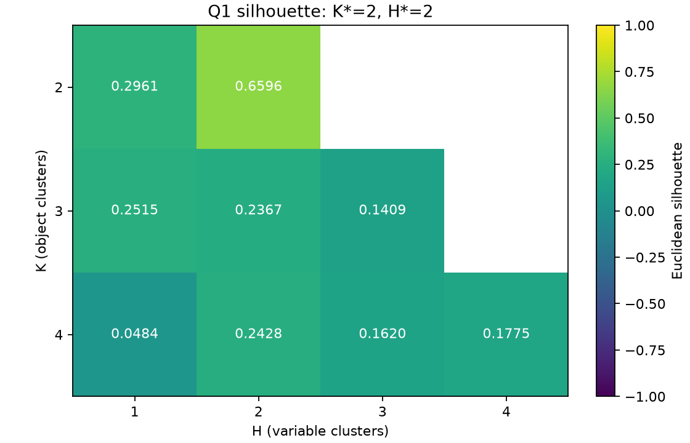
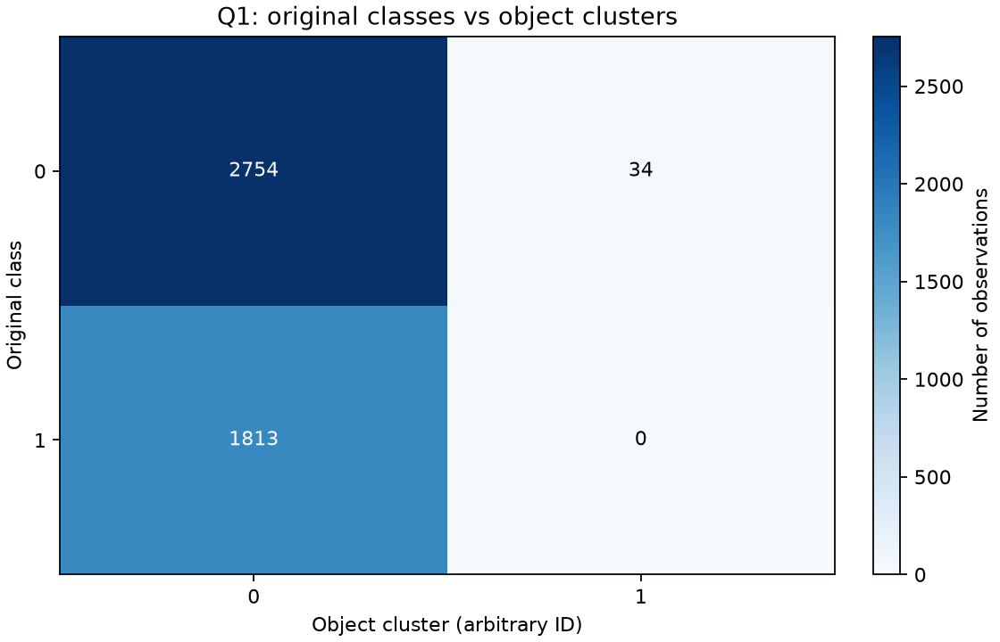
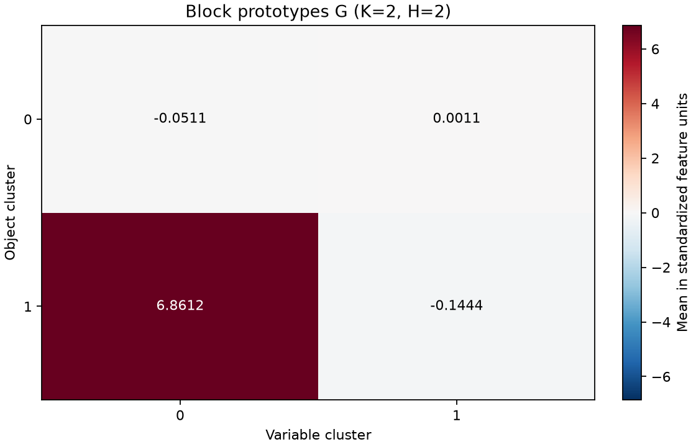
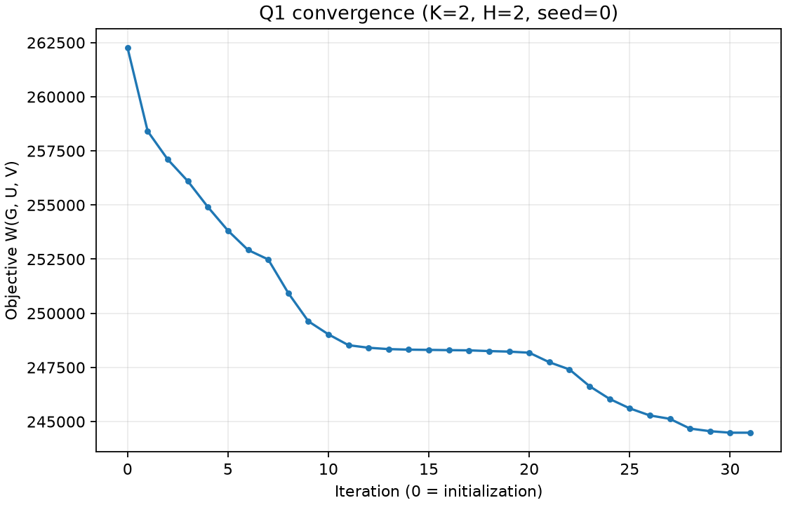

# Analise da Questao 1

## Protocolo e dados

- Spambase: 4601 observacoes, 57 atributos;
  a ultima coluna contem a classe original (0 = nao spam, 1 = spam).
- Padronizacao z-score por atributo no dataset completo, sem reordenar linhas.
  A classe original nao participa do ajuste nem da selecao por silhueta.
- 100 inicializacoes por par, em nove pares (K, H):
  900 ajustes. Sementes de 0 a 99.
- Em cada par, menor objetivo W; empate exato resolvido pela primeira semente.
  Entre pares, maior silhueta euclidiana completa; empate por menor K e depois H.
- Hash SHA-256 do CSV: `b1ef93de71f97714d3d7d4f58fc9f718da7bbc8ac8a150eff2778616a8097b12`.
- Convergiram 900 de 900 ajustes.
  Limite de iteracoes: 100.

## Comparacao por silhueta

| K | H | n_runs | best_run_id | best_objective | best_converged | silhouette |
| --- | --- | --- | --- | --- | --- | --- |
| 2 | 1 | 100 | 0 | 256513.74824370 | True | 0.29609380 |
| 2 | 2 | 100 | 0 | 244486.69834951 | True | 0.65963094 |
| 3 | 1 | 100 | 0 | 254414.01287916 | True | 0.25146824 |
| 3 | 2 | 100 | 82 | 239421.78540288 | True | 0.23673145 |
| 3 | 3 | 100 | 7 | 234585.86636711 | True | 0.14092129 |
| 4 | 1 | 100 | 0 | 253278.67951748 | True | 0.04842578 |
| 4 | 2 | 100 | 3 | 233358.70221378 | True | 0.24279690 |
| 4 | 3 | 100 | 8 | 228516.44366872 | True | 0.16196117 |
| 4 | 4 | 100 | 18 | 227250.87512132 | True | 0.17745596 |

Selecionado: **K*=2, H*=2, semente=0**,
com silhueta **0.65963094** e W=244486.69834951.
O menor objetivo global nao e o criterio para escolher K*: W e usado primeiro
dentro de cada par. A silhueta avalia separacao geometrica na escala padronizada,
nao a recuperacao das classes originais.

## Concordancia com a particao a priori

**ARI = -0.0049496989.** A concordancia ajustada e negativa: esta abaixo da esperada ao acaso sob o modelo de referencia do ARI. Os clusters nao recuperam a particao spam/nao spam.
ARI=1 indica particoes identicas a menos de permutacao; ARI proximo de zero
indica concordancia proxima da referencia ao acaso. Valores negativos sao possiveis.

Tabela de contingencia (linhas = classes originais, colunas = clusters):

| original_class | 0 | 1 |
| --- | --- | --- |
| 0 | 2754 | 34 |
| 1 | 1813 | 0 |

Os IDs dos clusters sao arbitrarios. Nao se interpreta a diagonal como acertos
de classificacao nem se renomeiam clusters como spam/nao spam.
A tabela e retangular quando ha mais clusters do que classes.

## Distribuicao dos clusters

| cluster | n_objects | fraction |
| --- | --- | --- |
| 0 | 4567 | 0.99261030 |
| 1 | 34 | 0.00738970 |

Maior cluster: 99.26% das observacoes.
Uma silhueta elevada pode coexistir com forte desequilibrio dos grupos e ARI
baixo; por isso a silhueta nao demonstra, sozinha, separacao de spam e nao spam.
As composicoes por classe na tabela acima devem ser examinadas junto dos tamanhos.
Nao se altera o K* selecionado a posteriori com base nas classes originais.

Grupos de variaveis:

| variable_cluster | n_features |
| --- | --- |
| 0 | 11 |
| 1 | 46 |

## Prototipos e convergencia

G contem as medias dos blocos na escala z-score, nao nas unidades originais:

| object_cluster | variable_cluster_0 | variable_cluster_1 |
| --- | --- | --- |
| 0 | -0.05107955 | 0.00107505 |
| 1 | 6.86118487 | -0.14440471 |

Execucao vencedora: 31 iteracoes;
convergencia: True.
W inicial=262251.38234877;
W final=244486.69834951.
A curva inclui a inicializacao (iteracao 0) e o valor ao fim de cada iteracao.

## Reprodutibilidade e proxima etapa

As analises reutilizam o historico, sem novos ajustes do clustering.
Os resultados completos e a interpretacao devem ser preservados junto do codigo:

- [Metricas](../results/q1_evaluation.json)
- [Scores](../results/silhouette_scores.csv)
- [Contingencia](../results/q1_contingency.csv)
- [Particao selecionada](../results/q1_selected_partition.npz)
- [Rotulos por linha](../results/q1_object_labels.csv)

Para a Q2, usar exatamente os rotulos da particao selecionada na ordem original
das linhas. Mesmo quando K*=2, esses rotulos nao sao as classes originais.
Nao confundir desempenho futuro de classificacao desses clusters com deteccao
de spam. A integracao do dataloader e a validacao cruzada da Q2 nao fazem parte
desta etapa.
