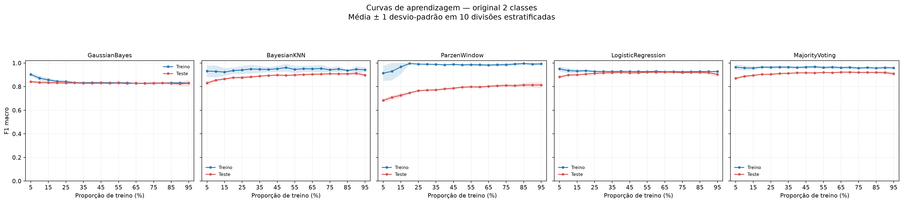
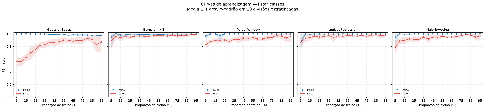

# Curvas de aprendizagem da Questao 2

## Reproducao

Execute na raiz do repositorio:

```bash
poetry run python -m src.experiments.learning_curves
```

O comando usa 10 repeticoes e `random_state=42`. Para mudar esses parametros ou
os diretorios de saida:

```bash
poetry run python -m src.experiments.learning_curves \
  --n-repeats 10 \
  --random-state 42 \
  --results-dir results \
  --plots-dir plots
```

O programa usa `get_learning_curve_splits` para criar divisões estratificadas,
com treino entre 5% e 95% dos dados em passos de 5%; cada teste usa a parte
complementar. Os dois datasets sao avaliados com os cinco classificadores.
Todos os estimadores sao recriados e ajustados em cada repeticao/tamanho.

Em cada conjunto de treino, os quatro classificadores base fazem busca em grade
por validacao cruzada estratificada, com `F1 macro` como criterio, e sao
reajustados no conjunto de treino completo com os melhores parametros. Os
valores candidatos sao os grids documentados nos respectivos classificadores.
O ensemble MajorityVoting e entao treinado com os quatro estimadores usando
esses parametros selecionados; nao existe uma busca independente para o
MajorityVoting no projeto.

Usa-se ate 5 folds internos; quando a menor classe tem menos de cinco exemplos,
o numero de folds e reduzido para a contagem dessa classe. Isso preserva a
estratificacao nos tamanhos pequenos. O GaussianBayes estima priores, medias e
covariancias por Maxima Verossimilhanca (divisor $N_i$), sem hiperparametros de
busca (`get_param_grid() == {}`). Como em `kstar_classes` a classe minoritaria
tem 34 exemplos para 57 atributos (chegando a apenas 2 exemplos no degrau de 5%)
e em `original_2_classes` atributos esparsos de palavras raras tambem apresentam
variancia nula nas subamostras menores, a covariancia MV pura torna-se singular
($\det(\hat{\Sigma}_i)=0$). Para garantir que a matriz seja definida positiva na
fatoracao de Cholesky em todos os tamanhos de treino (5% a 95%) sem introduzir
hiperparametros artificiais, adiciona-se um termo fixo de estabilizacao numerica
diagonal $\varepsilon I$ (`reg_covar = 1e-6`, padrao analogo ao Scikit-Learn).
O grid de k-NN exclui valores de `k` maiores que o menor tamanho de treino nos
folds internos.

As metricas de treino e teste sao F1 macro; cada grafico mostra a media das dez
repeticoes com faixa de mais/menos um desvio-padrao. Essa faixa descreve a
variabilidade entre as divisoes e nao e um intervalo de confianca.

## Arquivos gerados

- `results/learning_curves_data.csv`: um registro por dataset, classificador,
  tamanho e repeticao; inclui contagens de amostras, folds internos usados,
  hiperparametros selecionados e F1 macro de treino/teste.
- `results/learning_curves_summary.csv`: media e desvio-padrao dos F1 de treino
  e teste por dataset/classificador/tamanho.
- `plots/learning_curves_original.png`: cinco paines, um por classificador,
  para os rotulos originais spam/nao spam.
- `plots/learning_curves_kstar.png`: os mesmos cinco paineis para os clusters
  da Q1; esses clusters nao representam as classes originais de spam.

## Interpretacao

Use a separacao entre as curvas de treino e teste para avaliar ajuste:

- F1 de treino alto e F1 de teste consideravelmente menor sugerem sobreajuste.
- Ambas as curvas baixas sugerem que o modelo ainda nao captura bem o padrao
  (possivel subajuste).
- F1 de teste que cresce com o tamanho de treino e depois estabiliza sugere
  beneficio marginal decrescente de mais dados.
- A faixa de desvio-padrao indica sensibilidade a amostragem; compare-a entre
  tamanhos e modelos.

As curvas de `kstar_classes` medem previsao dos clusters da Q1, nao deteccao de
spam. Esse conjunto e fortemente desbalanceado, portanto F1 macro e o F1 da
classe minoritaria merecem atencao.

---

## Resultados e Comentarios

Foram executadas todas as **1.900 avaliacoes** (`2` datasets $\times$ `5` classificadores
$\times$ `19` proporcoes de treino de 5% a 95% $\times$ `10` divisoes estratificadas).
Os valores abaixo reportam $\text{Média} \pm \text{DP}$ do **F1-measure macro** nos
conjuntos de **Treinamento** e de **Teste** em pontos de referencia da curva
(a tabela completa com os 19 degraus esta em
[`results/learning_curves_summary.csv`](../results/learning_curves_summary.csv)).

### 1. Classes originais (`original_2_classes` — Spam vs. Nao-Spam)



| Classificador | Conjunto | 5% ($n=230$) | 10% ($n=460$) | 25% ($n=1150$) | 50% ($n=2300$) | 75% ($n=3450$) | 90% ($n=4140$) | 95% ($n=4370$) |
|---|:---:|---:|---:|---:|---:|---:|---:|---:|
| **GaussianBayes** | Treino | $0{,}9040 \pm 0{,}0155$ | $0{,}8718 \pm 0{,}0202$ | $0{,}8431 \pm 0{,}0113$ | $0{,}8329 \pm 0{,}0081$ | $0{,}8299 \pm 0{,}0058$ | $0{,}8317 \pm 0{,}0028$ | $0{,}8315 \pm 0{,}0027$ |
| **GaussianBayes** | Teste | $0{,}8422 \pm 0{,}0102$ | $0{,}8359 \pm 0{,}0144$ | $0{,}8304 \pm 0{,}0052$ | $0{,}8285 \pm 0{,}0071$ | $0{,}8294 \pm 0{,}0148$ | $0{,}8242 \pm 0{,}0190$ | $0{,}8290 \pm 0{,}0283$ |
| **BayesianKNN** | Treino | $0{,}9323 \pm 0{,}0493$ | $0{,}9290 \pm 0{,}0503$ | $0{,}9414 \pm 0{,}0337$ | $0{,}9613 \pm 0{,}0335$ | $0{,}9424 \pm 0{,}0208$ | $0{,}9473 \pm 0{,}0277$ | $0{,}9432 \pm 0{,}0199$ |
| **BayesianKNN** | Teste | $0{,}8311 \pm 0{,}0185$ | $0{,}8545 \pm 0{,}0108$ | $0{,}8773 \pm 0{,}0128$ | $0{,}8957 \pm 0{,}0063$ | $0{,}9092 \pm 0{,}0068$ | $0{,}9125 \pm 0{,}0154$ | $0{,}8976 \pm 0{,}0141$ |
| **ParzenWindow** | Treino | $0{,}9152 \pm 0{,}0654$ | $0{,}9297 \pm 0{,}0760$ | $0{,}9910 \pm 0{,}0025$ | $0{,}9846 \pm 0{,}0055$ | $0{,}9859 \pm 0{,}0113$ | $0{,}9912 \pm 0{,}0116$ | $0{,}9929 \pm 0{,}0111$ |
| **ParzenWindow** | Teste | $0{,}6830 \pm 0{,}0179$ | $0{,}7098 \pm 0{,}0182$ | $0{,}7658 \pm 0{,}0072$ | $0{,}7955 \pm 0{,}0074$ | $0{,}8103 \pm 0{,}0128$ | $0{,}8141 \pm 0{,}0223$ | $0{,}8141 \pm 0{,}0247$ |
| **LogisticRegression** | Treino | $0{,}9503 \pm 0{,}0219$ | $0{,}9360 \pm 0{,}0210$ | $0{,}9284 \pm 0{,}0089$ | $0{,}9282 \pm 0{,}0087$ | $0{,}9263 \pm 0{,}0031$ | $0{,}9281 \pm 0{,}0027$ | $0{,}9289 \pm 0{,}0015$ |
| **LogisticRegression** | Teste | $0{,}8828 \pm 0{,}0099$ | $0{,}8984 \pm 0{,}0092$ | $0{,}9120 \pm 0{,}0037$ | $0{,}9181 \pm 0{,}0075$ | $0{,}9187 \pm 0{,}0063$ | $0{,}9190 \pm 0{,}0161$ | $0{,}9037 \pm 0{,}0200$ |
| **MajorityVoting** | Treino | $0{,}9658 \pm 0{,}0219$ | $0{,}9587 \pm 0{,}0207$ | $0{,}9643 \pm 0{,}0132$ | $0{,}9681 \pm 0{,}0126$ | $0{,}9575 \pm 0{,}0085$ | $0{,}9611 \pm 0{,}0143$ | $0{,}9595 \pm 0{,}0100$ |
| **MajorityVoting** | Teste | $0{,}8709 \pm 0{,}0102$ | $0{,}8875 \pm 0{,}0110$ | $0{,}9045 \pm 0{,}0073$ | $0{,}9165 \pm 0{,}0052$ | $0{,}9205 \pm 0{,}0057$ | $0{,}9190 \pm 0{,}0132$ | $0{,}9101 \pm 0{,}0172$ |

#### Comentarios sobre `original_2_classes`:
- **`GaussianBayes` (Alto vies / Subajuste estrutural):** Apresenta convergencia rapida entre as curvas de treino e teste ja a partir de 25%–30% dos dados ($\approx 0{,}830$), com gap quase nulo ($\text{Treino} = 0{,}8315$ vs. $\text{Teste} = 0{,}8290$ em 95%). Curiosamente, o F1 de teste em 5% ($0{,}8422$) e ligeiramente superior ao de 90% ($0{,}8242$): com poucas amostras, muitas variaveis raras tem variancia zero e sao dominadas pelo termo isotropico $\varepsilon I$, aproximando o modelo de um classificador diagonal/esferico menos sensivel a correlacoes espurias em dados nao-normais.
- **`ParzenWindow` (Forte sobreajuste / Maldicao da dimensionalidade):** Exibe o maior gap entre treino ($\approx 0{,}99$) e teste ($0{,}6830 \rightarrow 0{,}8141$). Como o estimador de Parzen centra kernels gaussianos exatamente sobre os exemplos de treinamento em $\mathbb{R}^{57}$, a densidade no proprio ponto de treino e muito alta (memorizacao), enquanto no teste o modelo precisa de muito mais exemplos para preencher o espaco de 57 dimensoes. Ainda assim, e o modelo que mais ganha com mais dados ($+13{,}1$ pontos percentuais de F1 no teste entre 5% e 90%).
- **`BayesianKNN` (Ganho continuo com a densidade amostral):** O F1 de teste sobe consistentemente de $0{,}8311$ (5%) ate $0{,}9125$ (90%), mantendo um gap moderado ($\sim 0{,}035$) em relacao ao treino ($\sim 0{,}945$), pois vizinhancas locais em 57 dimensoes tornam-se muito mais fieis conforme $N$ cresce.
- **`LogisticRegression` e `MajorityVoting` (Melhor generalizacao e estabilidade):** Ambos partem de patamares altos ja com 5% dos dados ($0{,}8828$ e $0{,}8709$) e estabilizam por volta de 55%–70% ($\text{Teste} \approx 0{,}922$–$0{,}923$). Na `LogisticRegression`, a curva de treino desce de $0{,}9503$ (5%) para $0{,}9289$ (95%) enquanto a de teste sobe, formando a curva classica de aprendizado de um modelo linear bem regularizado (gap final $< 0{,}01$). Nos degraus de 90% e 95%, nota-se aumento do desvio-padrao no teste em todos os modelos porque o conjunto de teste passa a ter apenas $10\%$ ($461$) e $5\%$ ($231$) das observacoes.

---

### 2. Clusters da Q1 (`kstar_classes` — $K^*=2$, $4.567$ vs. $34$ exemplos)



| Classificador | Conjunto | 5% ($n=230$) | 10% ($n=460$) | 25% ($n=1150$) | 50% ($n=2300$) | 75% ($n=3450$) | 85% ($n=3910$) | 95% ($n=4370$) |
|---|:---:|---:|---:|---:|---:|---:|---:|---:|
| **GaussianBayes** | Treino | $1{,}0000 \pm 0{,}0000$ | $1{,}0000 \pm 0{,}0000$ | $1{,}0000 \pm 0{,}0000$ | $0{,}9942 \pm 0{,}0074$ | $0{,}9846 \pm 0{,}0112$ | $0{,}9793 \pm 0{,}0096$ | $0{,}9739 \pm 0{,}0037$ |
| **GaussianBayes** | Teste | $0{,}5689 \pm 0{,}0684$ | $0{,}5611 \pm 0{,}0785$ | $0{,}7547 \pm 0{,}0672$ | $0{,}8733 \pm 0{,}0477$ | $0{,}8935 \pm 0{,}0495$ | $0{,}9144 \pm 0{,}0631$ | $0{,}8726 \pm 0{,}1537$ |
| **BayesianKNN** | Treino | $0{,}9498 \pm 0{,}1588$ | $1{,}0000 \pm 0{,}0000$ | $0{,}9966 \pm 0{,}0106$ | $0{,}9954 \pm 0{,}0074$ | $0{,}9969 \pm 0{,}0071$ | $0{,}9956 \pm 0{,}0063$ | $1{,}0000 \pm 0{,}0000$ |
| **BayesianKNN** | Teste | $0{,}8950 \pm 0{,}1437$ | $0{,}9565 \pm 0{,}0361$ | $0{,}9495 \pm 0{,}0353$ | $0{,}9707 \pm 0{,}0224$ | $0{,}9678 \pm 0{,}0266$ | $0{,}9741 \pm 0{,}0276$ | $0{,}9899 \pm 0{,}0320$ |
| **ParzenWindow** | Treino | $0{,}9664 \pm 0{,}0707$ | $1{,}0000 \pm 0{,}0000$ | $1{,}0000 \pm 0{,}0000$ | $1{,}0000 \pm 0{,}0000$ | $1{,}0000 \pm 0{,}0000$ | $1{,}0000 \pm 0{,}0000$ | $1{,}0000 \pm 0{,}0000$ |
| **ParzenWindow** | Teste | $0{,}8325 \pm 0{,}0579$ | $0{,}8778 \pm 0{,}0280$ | $0{,}9039 \pm 0{,}0305$ | $0{,}9299 \pm 0{,}0398$ | $0{,}9468 \pm 0{,}0468$ | $0{,}9659 \pm 0{,}0444$ | $0{,}9580 \pm 0{,}0907$ |
| **LogisticRegression** | Treino | $0{,}8659 \pm 0{,}1539$ | $1{,}0000 \pm 0{,}0000$ | $0{,}9966 \pm 0{,}0106$ | $1{,}0000 \pm 0{,}0000$ | $1{,}0000 \pm 0{,}0000$ | $1{,}0000 \pm 0{,}0000$ | $1{,}0000 \pm 0{,}0000$ |
| **LogisticRegression** | Teste | $0{,}8694 \pm 0{,}0695$ | $0{,}9274 \pm 0{,}0568$ | $0{,}9495 \pm 0{,}0444$ | $0{,}9645 \pm 0{,}0328$ | $0{,}9620 \pm 0{,}0297$ | $0{,}9863 \pm 0{,}0221$ | $0{,}9798 \pm 0{,}0426$ |
| **MajorityVoting** | Treino | $0{,}9498 \pm 0{,}1588$ | $1{,}0000 \pm 0{,}0000$ | $1{,}0000 \pm 0{,}0000$ | $1{,}0000 \pm 0{,}0000$ | $1{,}0000 \pm 0{,}0000$ | $1{,}0000 \pm 0{,}0000$ | $1{,}0000 \pm 0{,}0000$ |
| **MajorityVoting** | Teste | $0{,}7891 \pm 0{,}1102$ | $0{,}8879 \pm 0{,}0412$ | $0{,}9141 \pm 0{,}0455$ | $0{,}9460 \pm 0{,}0359$ | $0{,}9722 \pm 0{,}0275$ | $0{,}9832 \pm 0{,}0270$ | $0{,}9664 \pm 0{,}0707$ |

#### Comentarios sobre `kstar_classes`:
- **Impacto da classe extremamente rara ($N_1 = 34$ no total):** No degrau de 5% ($n=230$), o conjunto de treino contem apenas **$2$ exemplos do Cluster 1**, enquanto no degrau de 95% ($n=231$ no teste) o conjunto de teste contem apenas **$2$ exemplos do Cluster 1**. Por isso, errar ou acertar **uma unica amostra** da classe minoritaria no teste altera drasticamente o F1 macro, explicando as faixas de desvio-padrao maiores nos extremos (5% e 90%–95%).
- **`GaussianBayes` (Forte sobreajuste inicial e grande evolucao com $N$):** Com 5% e 10% de treino ($2$ a $3$ amostras no Cluster 1), o `GaussianBayes` memoriza perfeitamente os poucos pontos de treino ($\text{F1 Treino} = 1{,}0000$), mas generaliza mal para o resto da nuvem da classe rara ($\text{F1 Teste} \approx 0{,}56$). Conforme mais exemplos do Cluster 1 entram no treino, a estimativa de $\hat{\mu}_1$ e $\hat{\Sigma}_1$ melhora substancialmente e o F1 de teste salta de $0{,}5689$ (5%) para $0{,}9306$ (80%) e $0{,}9144$ (85%).
- **`BayesianKNN` e `LogisticRegression` (Rapida recuperacao da fronteira do K-Means):** Como os dois clusters foram gerados por um metodo de particionamento geometrico no espaco padronizado, uma fronteira linear (`LogisticRegression`) ou vizinhanca local (`BayesianKNN`) ja atinge $\text{F1 Teste} > 0{,}92$ com apenas 10% dos dados ($3$ exemplos da classe rara no treino!) e supera $0{,}98$ a partir de 80% de treino.
- **`MajorityVoting`:** Em 5% de treino ($0{,}7891$), o voto majoritario e puxado para baixo pelo `GaussianBayes` ($0{,}5689$) e `ParzenWindow` ($0{,}8325$) devido a regra de desempate em 2×2 votos; a partir de 50% de treino, converge para o mesmo patamar de excelencia ($\text{F1 Teste} = 0{,}9722$ em 75% e $0{,}9889$ em 80%).
