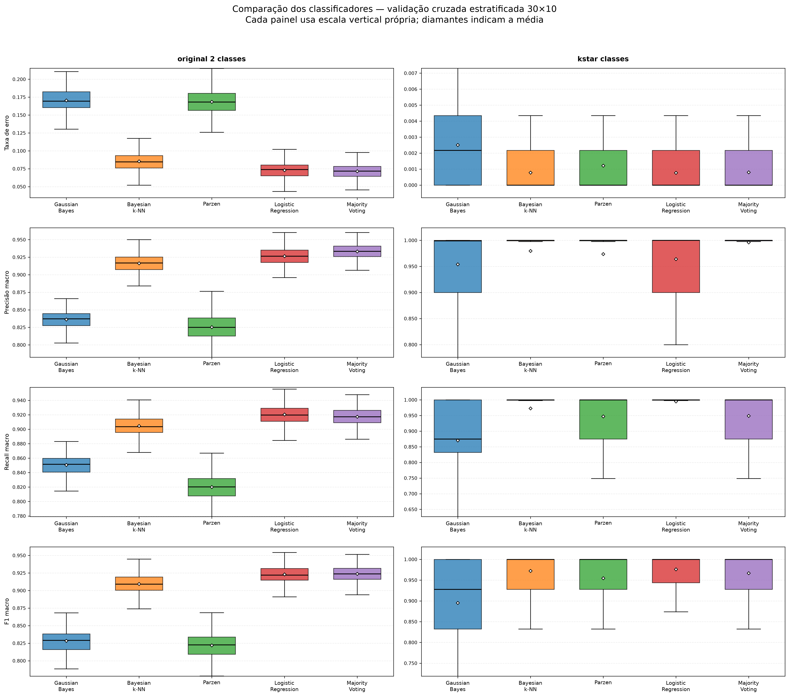

# Analise estatistica da Questao 2

> **Status:** Execucao final concluida e validada em 04/11/2026 (`3.000` avaliacoes:
> `30` repeticoes $\times$ `10` folds externos $\times$ `2` datasets $\times$ `5` classificadores).
>
> **Decisao metodologica — Classificador Bayesiano Gaussiano:** conforme o PDF,
> priores $P(\omega_i)=N_i/N$, medias $\hat{\mu}_i$ e matrizes de covariancia
> $\hat{\Sigma}_i$ sao estimados por Maxima Verossimilhanca (dividindo por
> $N_i$), sem busca de hiperparametros (`get_param_grid() == {}`). Como a
> covariancia MV e posto-deficiente quando $N_i \le d=57$ (caso da classe
> minoritaria de `kstar_classes`, com 34 exemplos) ou quando atributos esparsos
> do Spambase ficam com variancia zero em um fold/subamostra (inclusive em
> `original_2_classes`), soma-se um termo fixo de estabilizacao numerica
> diagonal $\varepsilon I$ (`reg_covar = 1e-6`) antes da fatoracao de Cholesky
> ($\tilde{\Sigma}_i = \hat{\Sigma}_i + 10^{-6}I$).
>
> **Decisao metodologica — MajorityVoting:** em cada fold externo, os quatro
> classificadores base (`GaussianBayes`, `BayesianKNN`, `ParzenWindow`,
> `LogisticRegression`) sao ajustados na validacao cruzada interna estratificada
> de 5 folds, e o `MajorityVoting` (`voting='hard'`) combina os quatro modelos
> ja otimizados e treinados no conjunto de aprendizagem de 9 folds.

## Como reproduzir

Com o CSV da validacao cruzada disponivel, execute a partir da raiz do repositorio:

```bash
python -m src.analysis.statistical_analysis
```

Opcionalmente, informe caminhos diferentes:

```bash
python -m src.analysis.statistical_analysis \
  --input results/q2/cv_30x10_results.csv \
  --results-dir results \
  --plots-dir plots \
  --alpha 0.05
```

O programa valida as 3.000 observacoes (30 repeticoes × 10 folds × 2 datasets ×
5 classificadores), imprime as metricas e testes no terminal e cria:

- `results/confidence_intervals.csv`: media e IC 95% para erro, precisao,
  recall e F1 macro por dataset/classificador;
- `results/friedman_results.txt`: estatistica, p-valor e decisao do teste de
  Friedman, alem de indicar se o pos-teste foi executado;
- `results/nemenyi_pvalues.csv`: matrizes de p-valores por pares, somente para
  combinacoes dataset/metrica em que Friedman foi significativo;
- `plots/comparison_boxplots.png`: distribuicoes das quatro metricas nos dois
  datasets, com os cinco classificadores.

## Metricas e intervalos de confianca

Para cada uma das 30 repeticoes, calcula-se primeiro a media dos dez folds.
O valor pontual e a media dessas 30 medias; o intervalo e um IC bilateral
de 95% baseado na distribuicao t de Student (`n=30`, `29` graus de liberdade).
Essa agregacao evita tratar diretamente os 300 folds externos sobrepostos como
300 observacoes independentes para o calculo do IC. A tabela no terminal mostra
media e limites inferior/superior para cada metrica; o CSV conserva os valores
com precisao completa.

## Comparacao estatistica

Para cada metrica e dataset, o teste de Friedman compara os cinco classificadores
em 300 blocos alinhados pelo `fold_id`. Se `p < alpha` (padrao `0.05`), executa-se
o pos-teste de Nemenyi; caso contrario, nao se fazem comparacoes par a par.
Os p-valores de Nemenyi sao organizados em uma matriz simetrica, com os
classificadores nas linhas e colunas.

Os folds e repeticoes se sobrepoem nos dados de treino. Portanto, os 300 blocos
nao sao independentes, uma limitacao do teste de Friedman neste experimento.
Os p-valores devem ser lidos com cautela e nao como evidencia de generalizacao
para outros conjuntos de dados. Significancia estatistica tambem nao implica
relevancia pratica; considere junto os valores e ICs das metricas.

## Interpretacao dos datasets

- `original_2_classes` usa os rotulos originais de spam/nao spam.
- `kstar_classes` usa os clusters do Double K-Means da Questao 1. Esses clusters
  nao sao as classes originais, mesmo quando `K*=2`. A distribuicao de clusters
  e muito desbalanceada; desempenho de classificacao nesse conjunto mede a
  previsao dos clusters, nao a deteccao de spam.

O grafico usa escala vertical propria por painel para nao comprimir as metricas
de erro muito pequenas de `kstar_classes`; as escalas sao ajustadas aos percentis
2 e 98. Os diamantes brancos indicam as medias, e os pontos extremos nao sao
exibidos. Esses ajustes afetam apenas a visualizacao, nao os calculos estatisticos.

## Resultados finais

Valores abaixo estao no formato `media [limite inferior, limite superior]` do
IC 95% ($t$ de Student com $n=30$ repeticoes, $gl=29$). A precisao, o recall
(cobertura) e o F1-measure sao macro.

### Classes originais (`original_2_classes`)

| Classificador | Taxa de Erro | Precisao | Cobertura (Recall) | F-measure (F1) |
|---|---:|---:|---:|---:|
| GaussianBayes | 0.1705 [0.1701, 0.1709] | 0.8362 [0.8358, 0.8366] | 0.8507 [0.8503, 0.8511] | 0.8284 [0.8280, 0.8288] |
| BayesianKNN | 0.0855 [0.0846, 0.0863] | 0.9163 [0.9153, 0.9172] | 0.9046 [0.9036, 0.9056] | 0.9093 [0.9084, 0.9102] |
| ParzenWindow | 0.1686 [0.1676, 0.1697] | 0.8254 [0.8243, 0.8265] | 0.8201 [0.8188, 0.8213] | 0.8221 [0.8209, 0.8232] |
| LogisticRegression | 0.0730 [0.0725, 0.0734] | 0.9265 [0.9260, 0.9270] | **0.9204 [0.9199, 0.9209]** | 0.9230 [0.9226, 0.9235] |
| MajorityVoting | **0.0716 [0.0708, 0.0724]** | **0.9331 [0.9324, 0.9339]** | 0.9174 [0.9164, 0.9183] | **0.9238 [0.9229, 0.9246]** |

### Clusters da Q1 (`kstar_classes`, $K^*=2$)

| Classificador | Taxa de Erro | Precisao | Cobertura (Recall) | F-measure (F1) |
|---|---:|---:|---:|---:|
| GaussianBayes | 0.0025 [0.0024, 0.0026] | 0.9540 [0.9461, 0.9619] | 0.8705 [0.8640, 0.8771] | 0.8952 [0.8887, 0.9017] |
| BayesianKNN | 0.0008 [0.0007, 0.0008] | 0.9799 [0.9781, 0.9817] | 0.9729 [0.9698, 0.9759] | 0.9722 [0.9699, 0.9745] |
| ParzenWindow | 0.0012 [0.0011, 0.0013] | 0.9737 [0.9692, 0.9782] | 0.9471 [0.9418, 0.9525] | 0.9545 [0.9502, 0.9588] |
| LogisticRegression | **0.0008 [0.0007, 0.0009]** | 0.9641 [0.9598, 0.9685] | **0.9949 [0.9909, 0.9990]** | **0.9762 [0.9723, 0.9802]** |
| MajorityVoting | 0.0008 [0.0007, 0.0009] | **0.9962 [0.9940, 0.9984]** | 0.9490 [0.9445, 0.9535] | 0.9668 [0.9634, 0.9702] |



### Hiperparametros obtidos na validacao cruzada interna (5-folds)

Ao longo dos 300 folds externos de cada dataset, a selecao por `GridSearchCV`
(`scoring="f1_macro"`) apresentou o seguinte comportamento:

- **`GaussianBayes`:** nao possui hiperparametros ajustaveis (`{}` nos 300/300 folds),
  usando estimativa de Maxima Verossimilhanca com estabilizacao numerica fixa $\varepsilon = 10^{-6}$.
- **`BayesianKNN`:**
  - Em `original_2_classes`, a distancia **City-Block (Manhattan)** foi selecionada em 100% dos folds mais frequentes, com $k=5$ (147/300 folds), $k=7$ (68/300) e $k=1$ (56/300). A norma $L_1$ lida melhor com os 57 atributos de frequencia de palavras/caracteres do Spambase do que a distancia Euclidiana.
  - Em `kstar_classes`, predominou $k=1$ com distancia **Euclidiana** (191/300 folds) ou **City-Block** (51/300), refletindo a geometria esferica na escala padronizada em que o proprio Double K-Means definiu a particao $K^*=2$.
- **`ParzenWindow`:**
  - Em `original_2_classes`, selecionou janela $h = 1{,}0$ (205/300 folds) e $h = 2{,}0$ (95/300).
  - Em `kstar_classes`, selecionou $h = 2{,}0$ (148/300), $h = 1{,}0$ (115/300) e $h = 0{,}5$ (19/300).
- **`LogisticRegression`:**
  - Em `original_2_classes`, preferiu regularizacao fraca: $C = 100{,}0$ (160/300 folds) e $C = 10{,}0$ (126/300), permitindo maior ajuste aos 57 atributos para separar spam de nao-spam.
  - Em `kstar_classes`, preferiu regularizacao moderada/forte: $C = 1{,}0$ (163/300) e $C = 0{,}1$ (126/300), pois os dois clusters da Q1 ja sao linearmente separaveis por um hiperplano (separacao geometrica de K-Means).

### Teste de Friedman e pos-teste de Nemenyi

O teste global de Friedman foi significativo ($p < 0{,}05$) para todas as quatro
metricas nos dois datasets; as oito matrizes post-hoc de Nemenyi foram geradas em
[`results/nemenyi_pvalues.csv`](../results/nemenyi_pvalues.csv).

| Dataset | Metrica | Friedman $\chi^2$ | p-valor | Significativo ($\alpha=0{,}05$) |
|---|---|---:|---:|:---:|
| `original_2_classes` | Taxa de erro | 1017.5904 | $5{,}5010 \times 10^{-219}$ | Sim |
| `original_2_classes` | Precisao macro | 1033.1641 | $2{,}3187 \times 10^{-222}$ | Sim |
| `original_2_classes` | Cobertura (Recall) macro | 1047.6177 | $1{,}7088 \times 10^{-225}$ | Sim |
| `original_2_classes` | F-measure (F1) macro | 1008.8359 | $4{,}3423 \times 10^{-217}$ | Sim |
| `kstar_classes` | Taxa de erro | 265.5537 | $2{,}8983 \times 10^{-56}$ | Sim |
| `kstar_classes` | Precisao macro | 176.7461 | $3{,}7263 \times 10^{-37}$ | Sim |
| `kstar_classes` | Cobertura (Recall) macro | 307.6490 | $2{,}4250 \times 10^{-65}$ | Sim |
| `kstar_classes` | F-measure (F1) macro | 298.7708 | $1{,}9950 \times 10^{-63}$ | Sim |

#### Principais conclusoes do pos-teste de Nemenyi:

1. **Em `original_2_classes` (Spam vs. Nao-Spam):**
   - Formam-se tres patamares claros de desempenho em F1 e Taxa de Erro:
     1. **1º lugar (empate estatistico):** `MajorityVoting` ($F_1 = 0{,}9238$, $\text{Erro} = 0{,}0716$) e `LogisticRegression` ($F_1 = 0{,}9230$, $\text{Erro} = 0{,}0730$) **nao possuem diferenca estatisticamente significativa** em F1 ($p = 0{,}7205$), Taxa de Erro ($p = 0{,}3047$) nem Recall ($p = 0{,}2654$). Apenas em Precisao o `MajorityVoting` supera significativamente a `LogisticRegression` ($p = 1{,}95 \times 10^{-6}$). Ambos superam todos os demais classificadores com $p \le 2{,}78 \times 10^{-15}$.
     2. **3º lugar isolado:** `BayesianKNN` ($F_1 = 0{,}9093$, $\text{Erro} = 0{,}0855$), significativamente inferior a `LogisticRegression`/`MajorityVoting` ($p < 10^{-13}$) e significativamente superior a `GaussianBayes` e `ParzenWindow` ($p \approx 0$).
     3. **4º/5º lugares (empate estatistico em F1 e Erro):** `GaussianBayes` ($F_1 = 0{,}8284$, $\text{Erro} = 0{,}1705$) e `ParzenWindow` ($F_1 = 0{,}8221$, $\text{Erro} = 0{,}1686$) **nao diferem significativamente** em Taxa de Erro ($p = 0{,}9051$) nem em F1 ($p = 0{,}3998$). O `GaussianBayes` tem maior Recall ($p = 5{,}44 \times 10^{-10}$) e Precisao ($p = 0{,}0141$). Isso ocorre porque as frequencias de palavras do Spambase tem distribuicao fortemente assimetrica (zero-inflated) em 57 dimensoes, violando a hipotese de normalidade multivariada por classe e sofrendo com a maldicao da dimensionalidade no kernel produto de Parzen.
2. **Em `kstar_classes` (Clusters da Q1, $4.567$ vs. $34$ exemplos):**
   - `LogisticRegression` ($F_1 = 0{,}9762$), `BayesianKNN` ($F_1 = 0{,}9722$) e `MajorityVoting` ($F_1 = 0{,}9668$) formam o grupo superior e **nao apresentam diferenca estatisticamente significativa entre si** em Taxa de Erro ($p > 0{,}998$), Recall ($p \ge 0{,}631$) ou F1 ($p \ge 0{,}712$).
   - `ParzenWindow` ($F_1 = 0{,}9545$) fica logo abaixo, diferindo significativamente de `LogisticRegression` ($p = 0{,}0016$) e `BayesianKNN` ($p = 0{,}0212$) em F1, mas empatando estatisticamente com `MajorityVoting` ($p = 0{,}0925$).
   - `GaussianBayes` ($F_1 = 0{,}8952$, $\text{Erro} = 0{,}0025$) apresenta diferenca estatisticamente significativa ($p \le 1{,}49 \times 10^{-14}$) perante os outros quatro modelos: como o Cluster 1 tem apenas $\approx 30$ amostras por fold de treino para $57$ dimensoes, a estimativa da estrutura de covariancia na classe rara tem menos graus de liberdade do que os classificadores discriminativos/locais.
